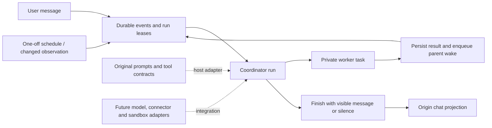

# Personal Agent Research

Research into **Grok Bot, Meta Muse and Manus Cue**, with recovered prompt
material, tool definitions, sanitized client traces, and an original Python
reference for building a community personal agent.

The project connects product observations to concrete implementation choices:
how a coordinator stays responsive, how workers return results privately, what
wakes an agent, and how results become clean chat messages. The runnable code
covers coordination semantics. A live model, browser, connectors, UI and enforced
sandbox are future integrations.

## Start here

| Your goal | Read or run |
|---|---|
| Understand findings and confidence limits | [STUDY.md](STUDY.md), then [PROMPT-FOLLOWUP.md](PROMPT-FOLLOWUP.md) |
| Inspect recovered prompts and worker instructions | [Prompt index](prompts/README.md) |
| Compare tool interfaces | [Configuration index](config/README.md) |
| See actual client request/event JSON | [Request and event index](requests/README.md) |
| Inspect collected source material | [Evidence index](evidence/README.md) |
| Build on the coordination core | [BUILD.md](BUILD.md), then [reference/README.md](reference/README.md) |
| Extend the project | [ROADMAP.md](ROADMAP.md) and [CONTRIBUTING.md](CONTRIBUTING.md) |

## Repository structure: what each part does

```text
.
├── README.md                 Entry point, component map and current status
├── STUDY.md                  Cross-product findings and evidence assessment
├── PROMPT-FOLLOWUP.md         Additional Grok archives, differences and Cue gaps
├── BUILD.md                  Community implementation contracts and integration guide
├── CAPTURE.md                Collection methods, sanitization and lab limitations
├── VALIDATION.md             Recorded validation of the research bundle
├── sources.json              Source URLs, pinned commits and provenance limits
├── FILE-HASHES.json          Integrity inventory maintained by tools/validate.py
├── evidence/                 Collected source material and provenance records
│   ├── grok/                 Public archives, skills and installed-client metadata
│   ├── muse/                 Runtime docs, prompts, schemas, connector and DB metadata
│   ├── cue/                  Addon manifests and the documentation-request result
│   └── manus-historical-*/    Older Manus material, separate from current Cue
├── prompts/                  Original community instructions and clean vendor splits
├── config/                   Tool contracts, normalized schemas, runtime design and diffs
├── requests/                 Sanitized client events and a synthetic model template
├── reference/                Executable Python/SQLite coordination core and tests
├── tools/                    Portable validation and integrity maintenance
├── ROADMAP.md                Research questions and implementation milestones
├── CONTRIBUTING.md           Evidence, code and review workflow
├── CHANGELOG.md              Research and repository milestones
└── LICENSE-ORIGINAL.txt      MIT grant for original work; excludes vendor evidence
```

| Layer | Responsibility | How to evolve it |
|---|---|---|
| `evidence/` | Preserve what was collected, its source and transformations | Add dated snapshots; retain earlier evidence and provenance |
| Research documents | Explain what evidence supports and what remains uncertain | Link claims to sources and update confidence explicitly |
| `prompts/` | Describe model behavior, distinguishing original and recovered text | Keep community prompts coherent and vendor snapshots versioned |
| `config/` | Describe tool inputs, host checks and runtime design choices | Version behavioral contracts; record normalization and changes |
| `requests/` | Show observable serialization and event shapes | Add narrow, sanitized probes with the observation boundary labelled |
| `reference/` | Execute coordination, private completion and explicit delivery | Add tested behavior behind trusted host interfaces |
| `tools/` | Check consistency and integrity | Extend validation for new artifact types |

## How the community reference works

This diagram describes the original reference and planned host-adapter boundary.
It does not describe a vendor's production infrastructure.



| Component | Implementation | Purpose |
|---|---|---|
| Event acceptance and leasing | `Engine.receive`, `Engine.claim` in [engine.py](reference/engine.py) | Deduplicate work, prioritize queued user work and fence stale runs |
| Worker lifecycle | `Engine.spawn`, `Engine.complete_worker`, `Engine.cancel` | Keep results private, wake the parent and cancel task trees |
| User delivery | `Engine.finish`, `Engine.messages` | Commit visible delivery and completion together; allow silence |
| Scheduled and observed wakes | `Engine.schedule_once`, `Engine.tick`, `Engine.observe` | Persist one-off schedules and detect changed observations |
| Model behavior | [Community prompts](prompts/README.md) and [five action contracts](config/community-tools.json) | Define the model interface; authority is enforced in host code |
| Failure/recovery checks | [test_engine.py](reference/test_engine.py) | Exercise deduplication, leases, late callbacks, cancellation and routing |

Clean chat is a delivery rule. Private reasoning, worker logs, transient progress,
approvals and permanent messages need distinct projections. Grok's public archives
use an explicit delivery tool; Muse's export describes selected final output and
bubble/attachment markers; Cue's client events distinguish deltas from permanent
chat messages. These findings inform the community design.

## Run and validate

Python 3.9+ is sufficient; no packages, API key or network are needed:

```sh
python3 reference/demo.py
python3 tools/validate.py
```

The demo accepts a synthetic message, dispatches a worker, handles its private
result, revives the coordinator and delivers to the original chat. Unchanged
background checks stay quiet. Validation runs eight tests and the demo, then
checks JSON, source/split integrity, authored links and the file inventory.
See [tools/README.md](tools/README.md) for maintenance commands.

Implemented: durable events, leases, worker lifecycle, cancellation, one-off UTC
schedules, change detection and atomic local delivery. Still to build: a live
model adapter, recurring/DST-aware scheduler, external-channel outbox, account
authentication, browser, connectors and enforced sandbox. [BUILD.md](BUILD.md)
defines their integration contracts.

## Evidence available and its limits

Research baseline: **24 October 2026**. Inspected versions: Grok Bot 0.75.8,
Muse 9.0 and Cue 1.1.4; [installed artifact hashes](evidence/installed-versions.json).

| Product | Included material | Limit |
|---|---|---|
| Grok Bot | [October collection](prompts/grok-public-2026-10-24/README.md): main prompt, eight variants, six context templates, 43 tools and 54 skills. [August archive](prompts/grok-public-2026-08-21/README.md): ten worker sections and 51 tools. Local metadata and sanitized events. | Public transcriptions are pinned but unauthenticated against the installed inference service. Inconsistencies and missing role-specific definitions are documented. |
| Meta Muse | [Direct runtime export](evidence/muse/README.md): startup prompt, 193 transcribed functions in 33 namespaces, 65 connector definitions and 197 DB table documents. | Agent-transcribed schemas are not inference captures. DB docs contain metadata, not rows. Required vendor services are absent. |
| Manus Cue | [Client events](requests/README.md), [addon manifests](evidence/cue/README.md) and attributed replies. | Current private prompt and model-facing tool catalog remain unrecovered. |
| Historical Manus | [Older prompt modules and 29 tools](evidence/manus-historical-2025-07-20/README.md) | Predates Cue; not evidence of the current Cascade harness. |

Request JSON is **client serialization/event evidence**. No TLS MITM export or
cloud harness-to-model request was captured. The community model template is
explicitly synthetic. [CAPTURE.md](CAPTURE.md) records collection boundaries;
[sources.json](sources.json) records external sources, commits and limits.

## Collaboration and reuse

Keep new evidence separate from implementation changes. Source updates should
state version, method, hashes, transformations and changed conclusions. Code
changes should explain behavior and validation. Use [CONTRIBUTING.md](CONTRIBUTING.md)
and the [roadmap](ROADMAP.md) to guide future work.

This repository is prepared for private collaboration through GitHub access
controls. Credentials, local account stores, unreviewed raw captures and personal
records are excluded. Publishing uses the existing authenticated client; its
credential is not stored in this repository.

Original code, community prompts and authored documentation have an
[MIT license](LICENSE-ORIGINAL.txt). Imported vendor files, captures and public
prompt transcriptions are excluded from that grant. Preserve their accompanying
source/license records. Vendor schemas and connector manifests are research
interfaces, not functioning vendor services.
