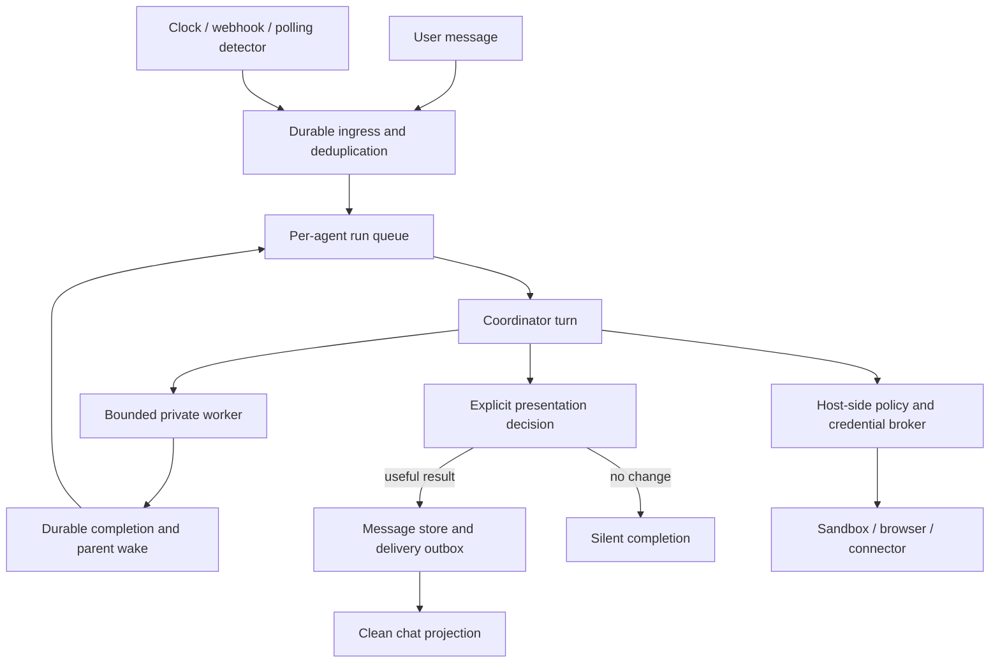

# Personal agents: what is actually recoverable

Study date: **24 October 2026, America/Los_Angeles**. Products inspected locally:
**Grok Bot 0.75.8, Muse 9.0, Cue 1.1.4**. Exact builds and artifact hashes are in
[installed-versions.json](evidence/installed-versions.json).

Yes: substantial reverse engineering already exists. Grok has the most extensive
public client/runtime reconstruction. Muse has the strongest public cloud-runtime
teardown, and this study obtained a much richer direct runtime export. Cue has
useful official APIs and an observable desktop protocol; its private harness and
current system prompt remain substantially less exposed.

**Follow-up:** the [additional prompt study](PROMPT-FOLLOWUP.md) now includes
two pinned public Grok archives: the October collection has a main prompt,
eight variants, six runtime templates, 43 tools and 54 skills; the earlier
archive has ten worker sections and 51 tools. These are public transcriptions,
not authenticated captures of this installed release. The current Cue prompt
is still unrecovered; historical Manus material is included separately.

The practical result is enough to implement a community agent's coordination,
scheduling, delivery, and recovery model. It is **not** a complete reconstruction
of any vendor's inference service or security enforcement.

## Read the evidence correctly

| Label | Meaning here |
|---|---|
| Observed client | A synthetic request or returned event captured at the installed client's serialization boundary |
| Installed static | A field, manifest, or route found in the installed application bundle |
| Direct runtime export | A file downloaded from the authenticated agent's environment; schemas are the agent's transcription of its exposed definitions |
| Vendor documented | A product or architecture claim in official documentation |
| Historical reconstruction | A third party's reconstruction of a specified earlier release |
| Public prompt transcription | A third party's published prompt/tool text, pinned to a commit but unauthenticated against this account's runtime |
| Proposed | An original community implementation decision |

These classes are not interchangeable. A schema in a client bundle may be unused.
A tool described by an agent is not a captured model request. A job finishing does
not prove its result was delivered. A new agent or task ID does not establish a new
VM, process, browser profile, or conversation context.

## Prior work worth using

| Work | What it contributes | Limit |
|---|---|---|
| [b-nnett/Grok 0.18 reconstruction](https://github.com/b-nnett/grok-bot-0.18-reconstructed) | Reconstructed host, coordinator, message protocol, toolsets, prompt assembly, scheduling and completion revival code | Archived, unofficial, and extended; not current 0.75.8 upstream source |
| [asgeirtj/Grok prompt collection](https://github.com/asgeirtj/system_prompts_leaks/tree/be9efc3ce7f31a79b698d95b4a93fee6178ce88b/xAI/grok-bot) | Main and worker/run prompts, runtime injections, 43 tools, 54 skills; earlier 51-tool archive also preserved | No original capture trace/version; mixed tool names and omitted role-specific definitions require care |
| [LING71671/Open-Grokbot](https://github.com/LING71671/open-grokbot) | Independent implementation of multi-agent coordination, transport, queues, messaging and state | Author's architecture reimplementation; GPL-3.0-only, not a fidelity guarantee |
| [Rohan Adwankar: What's in a Muse?](https://rohanadwankar.github.io/posts/sandbox2.html) | First-person shell/runtime investigation, VM/container split, storage, harness and browser broker | One inspected environment; hardware and deployment details can change |
| [Cygankiewicz: Muse control-plane experiments](https://blog.cygankiewicz.com/en/meta-muse-black-box-testing/) | Durable parent/child records and recovered spawn errors; aggregation failure despite completed workers | Small experiment set; neither a concurrency benchmark nor proof of a particular contended lock |
| [RomanSlack/Muse prompt collection](https://github.com/RomanSlack/Meta_Muse_Agent_System_Prompt_Tools) | Broad prompt/tool transcription useful for discovery | PDF transcription does not authenticate its original source; the direct export here is preferable |
| [txcript's Grok format notes](https://docs.rs/crate/txcript/latest/source/docs/formats/grok-bot.md) | Concrete transcript/store format observations | Version-specific format research, not a whole-product implementation |

Repository commits and reuse/provenance notes are recorded in [sources.json](sources.json).
The historical reconstruction has a `NOTICE.md`; it should not be assumed to grant
the same reuse rights as Open-Grokbot. This package's original reference and prompts
have their own [MIT grant](LICENSE-ORIGINAL.txt), which excludes vendor evidence.

## 1. Grok Bot

### The current client: separate acceptance, activity and visible delivery

A controlled request to the installed app produced this actual local RPC shape:

```json
{
  "kind": "request",
  "requestId": "<request>",
  "method": "sendPrompt",
  "args": {
    "agentId": "<agent>",
    "prompt": "<synthetic probe>",
    "clientNonce": "<nonce>",
    "directAddressedAcceptance": true,
    "source": "desktop",
    "firstSentAtMs": 1792905121379,
    "richText": "<serialized editor document>",
    "language": "en",
    "traceparent": "<trace>",
    "enterEpochMs": 1792905121331
  }
}
```

This is a **MessagePort request from renderer toward coordinator**, not an HTTPS
request to a model provider. The returned transcript event for the visible answer
was structurally different:

```json
{
  "kind": "event",
  "family": "transcript",
  "payload": {
    "type": "appended",
    "entry": {
      "kind": "send-message",
      "id": "<message>",
      "message": {"type": "text", "content": "RESEARCH_PROBE_20261024_FOURTH_ACK"},
      "timestampMs": 1792905124902,
      "requestId": "<turn-request>",
      "seq": 14
    },
    "agentId": "<agent>",
    "ordered": {"replicaKey": "<replica>", "epoch": "<epoch>", "sequence": 9}
  }
}
```

Separate `agent-activity` events carried run/composition state, unread counts,
message previews and settlement metadata. Activity reported a `SetStatus` tool
label during the probe. That is an observed activity label, not a recovered tool
definition. These distinct events explain how a messaging UI can stay clean while
work proceeds behind it. The complete sanitized records are in
[grok-client-observed.json](requests/grok-client-observed.json).

### The explicit message tool is historically concrete

The 0.18 reconstruction contains a `SendMessage` schema with typed text,
attachment, widget, cloud-agent card and secure-input variants. Its channel field
can direct supported text/attachments to a connected channel; omission uses the
in-app chat. The schema separates text from attachment/card fields and rejects
misplaced fields rather than silently dropping them.
[Historical schema source](https://github.com/b-nnett/grok-bot-0.18-reconstructed/blob/a9f633e09d49a85829b8236331b9e21f7e612634/source/host/runner/tools/send-message-schema.ts).

The current `send-message` transcript event is consistent with explicit delivery,
but it does **not** independently recover today's model-facing tool name or full
input schema. The live bot declined the direct prompt/schema request. The newly
included [public October prompt](prompts/grok-public-2026-10-24/README.md)
names `SendToUser` and supplies a detailed schema with `end_turn`. That is a
substantial public recovery, but its match to the installed service remains
unverified. See the [follow-up](PROMPT-FOLLOWUP.md) for its exact provenance and
internal inconsistencies.

### Coordinator, workers and routines

The historical implementation has separate host and coordinator components, a
gateway transport, transcript projections, and background completion handling.
Its completion path collects child results, resolves the parent's background
session, queues an exclusive run, and supplies a revival prompt. Quiet origins
carry a rule permitting no visible message when nothing useful changed.
[Completion path](https://github.com/b-nnett/grok-bot-0.18-reconstructed/blob/a9f633e09d49a85829b8236331b9e21f7e612634/source/host/extensions/transcript/completion-revivals.ts).

The automation path likewise resolves the owning agent's background session,
queues work and invokes the runner with hidden input. A routine is therefore
more than a timer that appends a normal user bubble.
[Automation path](https://github.com/b-nnett/grok-bot-0.18-reconstructed/blob/a9f633e09d49a85829b8236331b9e21f7e612634/source/host/extensions/transcript/automation-run-path.ts).

Official routines documentation supports clock schedules and external events,
including webhooks. A successful webhook acceptance does not mean its instruction
has finished. Connector access and event-trigger availability must be treated as
separate capabilities. [Grok routines](https://prod.cursor.com/help/grok-bot/routines).

### Sandbox and prompt boundaries

Current documentation says Bots share an account-level cloud computer: files and
sign-ins are not isolated per Bot. Do not design from the older shorthand that
every named bot necessarily receives a separate VM. The historical toolset also
distinguishes cloud `Shell`/`Read`, user-computer `ExternalShell`/`ExternalRead`,
browser/computer workers, and separately launched cloud coding agents.
[Current computer boundary](https://prod.cursor.com/docs/grok-bot/work),
[historical toolset](https://github.com/b-nnett/grok-bot-0.18-reconstructed/blob/a9f633e09d49a85829b8236331b9e21f7e612634/source/host/runner/tools/turn-toolset.ts).

The reconstructed prompt is assembled from a base, identity, memory, channels,
automations, workflows, directory and computer context. Copying the base text alone
would omit important instructions and state. See the
[prompt assembly map](prompts/grok-historical-prompt-map.md).

The installed bundle yielded 2,425 protobuf message descriptors and a coordinator
method-label catalog. They include shared Cursor-family definitions; they are not
2,425 available Grok tools. [Static catalog](evidence/grok/shipped-protobuf-descriptors.json).

## 2. Meta Muse

### What was obtained directly

The native agent exported its startup prompt file, runtime docs, connector
documentation/manifests, database schema documentation, and transcribed tool
definitions. The archive contained 453 files including its manifest. We verified
all 452 hashes listed by the source manifest, parsed the JSON, and retained 449
files after excluding account-specific inventory and a personal heartbeat file.
The exporter commentary's personal-identifier list was redacted. The locally
generated [audit](evidence/muse/runtime-export/EXPORT-AUDIT.json) records this.

The schema export contains **33 namespaces and 193 functions**. Two names mentioned
in descriptions but not returned by namespace loads are explicitly missing:
`idea.share` and `widget.create_image_picker_widget`. Some long descriptions were
summarized by the exporting agent. Parameter definitions are transcriptions, not
raw model-request bytes. Use the [namespace files](evidence/muse/runtime-export/schemas/)
as evidence and the [normalized manifest](config/muse-tools.normalized.json) as a
convenient conventional tool-schema wrapper.

### Main-chat delivery does not require a send-to-user tool

The startup prompt specifies normal final responses, with `<message_break/>`
separating chat bubbles and attachment markers producing native attachment cards.
It also says not to emit commentary. This supplies a second mechanism for the
same clean DM experience: the host parses selected final output into messages.
[Downloaded prompt](evidence/muse/runtime-export/prompt/system_prompt.md).

Separate tools have different jobs:

- `chat.send_message` instructs another chat's agent/worker. Its submission receipt
  is not completion. A native chat responds in that chat; an external group worker
  reports privately to the main agent.
- `worker.update_discretion` records the external chat's disclosure rules.
- `muse.react_to_user_message` provides a lightweight acknowledgement.
- `muse.nothing_to_do` marks an internal handoff that should not become a reply.
- `proactivity.select` records per-item send/skip decisions and format/reason, but
  explicitly sends nothing. Selection and visible delivery are separate steps.

The exported prompt requires the main agent to render a worker's important result
as its own user-facing message, preserving attribution and needed context. It
does not make worker output directly visible just because the worker finished.
[Chat schemas](evidence/muse/runtime-export/schemas/chat.json),
[proactivity schemas](evidence/muse/runtime-export/schemas/proactivity.json).

### Background execution has several distinct layers

| Mechanism | Exposed contract | Boundary established by this evidence |
|---|---|---|
| Generic child | `subagent.spawn/send/list/resume/close`; inherited current context; asynchronous result handoff | Separate agent bookkeeping and parent relationship; no proof of a fresh VM per child |
| Cron | Saved schedule, definition, execution, owner and delivery destination | Schema docs include run-specific worker IDs, phases, attempts and boot generation |
| Hook | Bash detector emits one `silent` or `wake`; a wake starts a worker instruction | Cheap condition polling is separate from model execution; detector has no connector credentials |
| Workflow | VM-local JS with `agent`, `parallel`, `pipeline`, stable child keys and schema results | Deterministic orchestration layer; shared per-run working directory; not unrestricted Node execution |
| Browser task | Dedicated brokered task, ownership and handoff | Distinct task lifecycle; generic subagent management is not an interchangeable browser driver |
| Background improvement | Platform-managed memory/relationship/idea/study/dream/skill passes | Documented scheduled behavior, not something the conversational agent schedules itself |

The scheduling guide explicitly says **both crons and hooks poll**. Hooks are
condition-driven at the model boundary, but their detector is clock-driven. This
corrects a tempting but inaccurate interpretation of “event based.” A genuine
stream listener is instead a long-lived service; it has different startup,
supervision and recovery requirements.
[Scheduling guide](evidence/muse/runtime-export/docs/chat/scheduling-and-watching.md).

The exported self-improvement document describes hourly memory/relationship work,
daily idea/study/skill passes, nightly reflections, and a bounded quiet-moment
pass. These are documented cadences, not timings measured in this experiment.
The Gmail connector metadata separately declares a 60-minute sync cadence; that
does not establish a universal notification latency or an email-arrival webhook.
[Background passes](evidence/muse/runtime-export/docs/self_improvement.md),
[Gmail metadata](evidence/muse/runtime-export/connectors/gmail/connector.yaml).

### The database documentation exposes the control plane

The export includes **197 table documents** and a schema index declaring migration
set `ea57eb152feee1656375efacb595db61ddbfd5125d9fab6fe2b71107998706d7`.
This fingerprints the documentation's migration set; it is not an independently
queried running-server release identifier. No user records were requested.

Particularly useful contracts are:

- `agent.agents`: parent/root/session identity, kind, model field, status, depth,
  ephemeral flag and handoff high-water position.
- `agent.message_mailbox`: submission ID, accepted ordinal, conversation epoch,
  routing scope, state and transcript-event link.
- `scheduler.job_runs`: job-definition version, request, scheduled occurrence,
  worker identity/phase/boot generation, attempts and execution timestamps.
- `scheduler.delivery_outbox`: payload, state, attempts, next retry, boot generation
  and delivered timestamp.
- `runtime.workflow_agent_calls`: replay/cache key, child identity, phase, status,
  result and cached-from relationship.
- `agent.recovery_owners` and restart checkpoints: durable ownership and recovery
  generations distinct from a currently running process.

These are concrete schema contracts for acceptance, execution, completion,
recovery and delivery. They do not reveal the transaction code or prove all
runtime invariants are correctly enforced. Start with the portable
[database index](evidence/muse/runtime-export/DB-INDEX.md).

### Tools, connectors and the security boundary

The tool catalog uses deferred namespace loading through
`tool_search.load_tool_namespace`. Connector discovery and CLI documentation are
separate from these namespace schemas. The bundle contains docs plus
`connector.yaml`/`manifest.yaml` for **65 connectors**, including auth setup,
domains, multi-account handling, sync metadata and request quotas where declared.
CLI binaries themselves were not exported. Public vendor OAuth client identifiers
in evidence are not credentials to reuse: a community implementation needs its
own app registrations and broker implementation.

Meta documents a per-user VM with a runtime cell separated from Sentinel,
credential services, privileged connector workers and PostgreSQL. Secrets are
surrogated and inserted at the authorized network boundary; approval dialogs
communicate between the client and Sentinel outside the agent's chat authority.
[Meta security architecture](https://research.meta.ai/blog/security-and-safety-for-ai-agents-our-approach-with-muse).

Adwankar's investigation identifies Cloud Hypervisor with a systemd-nspawn cell,
persistent storage and a Rust Hatch harness, plus brokered browser environments.
This study did not reproduce his host inspection or establish the VMM for this
account. [Independent teardown](https://rohanadwankar.github.io/posts/sandbox2.html).

**Important correction to the exported agent commentary:** its architecture notes
sometimes place “the runtime” outside the VM and describe browser/shell placement
too broadly. The better-supported distinction is **outside the runtime cell**,
with some services inside the user's VM and other infrastructure remote. The
word “runtime” alone does not locate a process. The source notes are preserved
as attributed commentary, not adopted as verified topology.

## 3. Manus Cue

### A real request/response pair

The installed Cue client sent a Socket.IO event over
`wss://api.manus.im/socket.io/`. Its packet prefix was `42`, followed by a JSON
array whose event name was `message`. The request object included:

```json
{
  "id": "<client-message>",
  "type": "user_message",
  "messageStatus": "pending",
  "sessionId": "<session>",
  "content": "",
  "contents": [{"type": "text", "value": "<synthetic probe>"}],
  "messageType": "text",
  "taskMode": "agent",
  "agentVersion": "agent",
  "attachments": [],
  "extData": {"capabilities": {}, "mode": "lite"},
  "countryIsoCode": "US",
  "bubbles": ["<synthetic probe>"],
  "deliveryMode": "interrupt"
}
```

The reply arrived through a transient `chatDelta` event, a durable `chat` event,
and notification/projection updates. The transient event referenced the final
target event ID and used `noPersistent: true`. Later `chat` updates reused the
same message ID while adding metadata. Notifications carried display preview,
unread count, background-job state and session status.

That is enough to implement a similar client projection: transient streaming
state plus an idempotent durable message upsert plus separate sidebar/activity
updates. It does **not** expose a model-facing messaging tool. The `interrupt`
field was observed; actual preemption of running work was not tested. Likewise,
`qualityMode` and `agentVersion` strings are not model identity evidence.
[Complete sanitized trace](requests/cue-client-observed.json).

### Public task model and local MCP integration

The official API says a Cue agent has a persistent main task. `task.sendMessage`
addresses it, while `task.list` with `scope=agent_subtask` enumerates agent-created
subtasks; task APIs can message or stop those subtasks. These external APIs
establish useful entities and lifetimes, not the LLM's private tool list.
[Manus agent API](https://open.manus.im/docs/v2/agents-overview).

The installed desktop bundle exposes a separate local computer-operator path.
The installed `manus-computer-use` addon manifest declares a socket MCP transport
and its native helper; `skill-recorder` shares that helper and declares a stdio
transport. The shipped JS runtime includes platform computer-use documentation
and a constrained JavaScript execution layer. These are local desktop capabilities,
not proof of how cloud subtasks are sandboxed.
[Computer-use manifest](evidence/cue/manus-computer-use.addon.json),
[recorder manifest](evidence/cue/skill-recorder.addon.json).

Cue's direct agent reply provided public evidence and explicitly withheld its
protected runtime prompt and exact private schemas. No such material was recovered.
The launch article associates Cue with Manus infrastructure and the Cascade era;
it does not resolve context inheritance, queue arbitration, worker provisioning,
or exact safety-service placement for Cue.
[Manus 2.0 announcement](https://manus.im/blog/introducing-manus-2-0).

## 4. What the community implementation should preserve

Keep six identifiers distinct: **account, agent, conversation, run, execution
environment, delivery channel**. Add explicit parent and origin relationships.
An event should preserve who authorized the work, where its result belongs, and
which generation of work may still commit a result.

The useful common pattern is:



The diagram is a proposed community design, not a universal vendor topology.
Grok's explicit message tool and Muse's final-output parser are two viable
presentation mechanisms. The invariant is that private work, status, approvals,
and user-visible messages have explicit routing and persistence semantics.

The engineering work that matters most is durable acceptance, lease fencing,
idempotent tool receipts, parent revival, quiet-result suppression, source-event
cursors, lifecycle ownership, and outbox delivery. Prompt wording helps the model
use these mechanisms; it cannot implement them or create a security boundary.

The included [BUILD.md](BUILD.md), prompts, tool/config files and runnable
[reference](reference/README.md) turn these findings into an implementation plan.
Eight tests cover restart/deduplication, serialization/priority, stale leases,
private handoff, origin routing, silence, scheduling and cancellation. The
reference is a coordination starter, not a production sandbox or complete UI.

## 5. Capture scope and remaining unknowns

We extracted copies of shipped client bundles, used synthetic probes, observed
serialization/events with app-scoped debugger connections bound to loopback, and
downloaded Muse's files through its native Library. The initial HTTP-only observer
did not reveal the relevant traffic; Cue used WebSocket framing and Grok used
renderer/coordinator MessagePorts. Targeted boundary observation supplied the
JSON in `requests/`.

**No TLS MITM capture was obtained. No cloud harness-to-model inference request
was captured.** The saved client JSON is actual observed data, with identifiers
pseudonymized, but it must not be relabelled as an inference payload. A synthetic
community model-request template is separately marked. No certificate trust or
TLS-validation setting was changed. The temporary debugging launches were removed
and their loopback ports verified closed.

A stale UI control briefly opened a Grok voice chat; it was closed, and its UI
record showed approximately twelve seconds. No research probe relied on voice.
This was an unintended lab action, not part of the evidence for product internals.

Still unknown: authenticated current Grok/Cue full prompt stacks and role-specific
model schemas (public Grok transcriptions are now included); production model
routing and sampling; exact provider request bodies; scheduler queue/transaction
implementations; precise context budgets and compaction policies; per-worker
process/VM provisioning where undocumented; complete approval classifiers and
policy code; production-scale latency/cost and failure rates. These are concrete
limits of observation, not missing community design requirements. The build can
proceed by choosing and testing explicit contracts for each.
